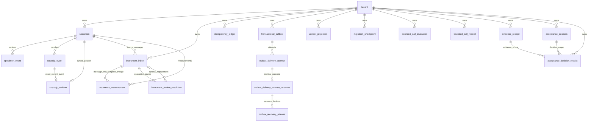

# Database model and pending-outbox query

The versioned [SQL migrations](../sql/) define this model. V001–V005 establish
20 public business tables and 26 foreign-key constraints. V006 adds the bounded
invocation-release routine; V007 adds the pending-outbox index. The diagrams
show declared foreign keys. Every business table carries tenant identity and
forced row-level security; a signed tenant context supplies ordinary callers'
authority. `laboratory_security` owns the separate verification-key boundary.

## Declared entity relationships

Each child row belongs to the parent shown. A parent can exist before its child.
All child-to-business-parent foreign keys include `tenant_id`; tenant-root
foreign keys use `tenant_id` alone. Multiple inbox constraints between the same
entities appear on one labeled edge.



| Source | Key and additional relationship meaning |
| --- | --- |
| V001 | `specimen` uses `(tenant_id, specimen_id)`; events use aggregate version and unique event/command identities. Evidence joins preserve intended-use and release-claim identity in both parent keys. |
| V002–V004 | Custody position points to the exact resulting version and transfer. Measurement lineage binds message, specimen, raw digest, captured time and source disposition. Multiple analytes may belong to one message. |
| V004 | Attempts use `(tenant_id, message_id, attempt_number)` and unique lease/fence identities. One terminal outcome may belong to each attempt; one release decision may belong to its recovery outcome. |
| V005 | Each quarantined message has at most one resolution. An accepted replacement points to a message for the same specimen and an admitted source disposition; a source-error closure retains an absent replacement. |

The adapter associates `bounded_call_receipt.call_id` with invocations while
receipts also represent denials before reservation; the database declares its
tenant foreign key only. Outbox `aggregate_id` and vendor `external_identity`
are general identifiers. The specimen view matches them to `specimen_id`;
these associations are query semantics rather than specimen foreign keys.

`laboratory_owner` owns 16 business tables. `laboratory_outbox_authority` owns
the outbox and its three evidence tables. Ordinary application and worker roles
operate through their column grants and trusted routines. Table ownership,
forced row-level security, routine execution grants and relation qualification
jointly define the write boundary; an ERD records relational shape alone.

## Observe the pending lookup

The source view's lateral count selects by tenant and aggregate, then retains
rows whose state differs from `delivered`. V007 uses that same predicate in its
partial index. PostgreSQL can choose the smaller matching index when the query
implies its predicate. The index adds storage and maintenance for pending rows
and their state transitions. A full composite index, a grouped-count rewrite,
and a persisted counter were considered; the partial index preserves current
view semantics with the smallest write and consistency surface. See
[PostgreSQL 17 partial indexes](https://www.postgresql.org/docs/17/indexes-partial.html).

With the existing configured synthetic test identities:

```sh
python3 -m unittest tests.test_pending_outbox_postgres -v
```

The module verifies the catalog keys/predicate and ordinary-role counts for
ready, leased, delivered and recovery-required messages, empty specimens and
another tenant. It then observes `EXPLAIN (ANALYZE, BUFFERS, FORMAT JSON)` as
`laboratory_app` with a signed context: 1,000 specimens and 10,000 pending
messages, ten per specimen. The control tenants add four mixed-state messages
and seven ready messages. Output contains normalized node rows, loops, buffer
hits/reads and elapsed time. Counts define correctness; planner choices and
timing remain observations. The existing PostgreSQL 17/Flyway clean and upgrade
jobs include this module. A local PostgreSQL 18.6 observation identifies that
engine separately from the supported route.

For a before/after comparison, seed an invocation-owned V006 database, observe
the query, apply V007 as the migrator, then repeat with the same principal,
data, statistics and server settings. Record engine version, returned counts,
scan loops and buffers alongside the selected index. Warm-cache timing is
illustrative. `EXPLAIN ANALYZE` measures server execution; Python allocation,
response encoding and network cost need their own observation. See
[PostgreSQL 17 EXPLAIN](https://www.postgresql.org/docs/17/using-explain.html).

The complete workbench summary still fetches and materializes all tenant
specimens. Its response and Python object cost grow with specimen count even
when each pending lookup is indexed. [Issue #38](https://github.com/driftframestudios/lims-eln-enterprise-implementation/issues/38)
owns the bounded API, aggregate and pagination route.

## Reconcile diagrams with a configured catalog

Run this read-only catalog query after the migration route to inspect each
foreign key, including its full composite coordinate:

```sql
select source.relname as child, target.relname as parent,
       pg_catalog.pg_get_constraintdef(constraint_row.oid) as definition
from pg_catalog.pg_constraint as constraint_row
join pg_catalog.pg_class as source on source.oid = constraint_row.conrelid
join pg_catalog.pg_class as target on target.oid = constraint_row.confrelid
join pg_catalog.pg_namespace as namespace on namespace.oid = source.relnamespace
where constraint_row.contype = 'f' and namespace.nspname = 'public'
order by child, parent, definition;
```

Compare the returned keys to the versioned migrations and each edge above.
Local catalog inspection observed 20 tables and 26 foreign keys on
PostgreSQL 18.6 through direct transactional SQL. The
[resource cleanup hosted receipt](../receipts/hosted-postgresql-resource-cleanup-proof.json)
records the PostgreSQL 17.10/Flyway clean and upgrade database controls at source
`ae213e7c01262431030a2a8d81129bed090f1376`. Its
[normalized plan observations](../receipts/postgresql-resource-cleanup-plan-observations.json)
record both ordinary-role runs with 1,000 specimens and 10,000 pending messages.
Each selected an index-only outbox scan with 10 rows per loop over 1,000 loops and
12,000 outbox shared-buffer hits. The emitted sample records scan type and
buffers; the separate catalog test verifies the named partial index's keys,
predicate, owner and final schema privilege boundary. Timings describe those
synthetic runs. Complete summary materialization retains its O(N) result and
allocation cost.

The [retained V007 plan observations](../receipts/postgresql-v007-plan-observations.json)
preserve the earlier source coordinate and measured executions. The successor
records the same fixture after the resource cleanup repair; each observation
keeps its own execution times and buffer counts.
